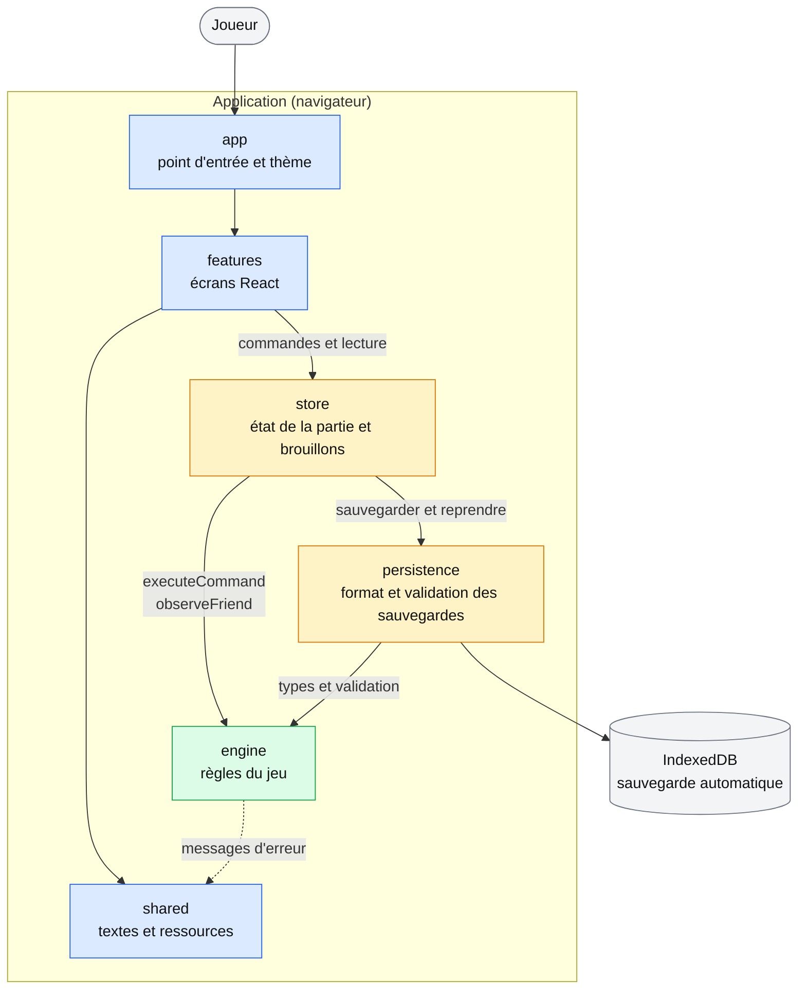

# 1. Architecture générale

Les grandes couches de l'application, de l'écran jusqu'au stockage. Le moteur de règles ne dépend de rien : c'est le cœur, que le reste appelle.

## Lecture

- **Le sens des flèches est celui des appels** : l'interface parle au store, le store parle au moteur. Jamais l'inverse.
- **Le moteur est pur** : ni React, ni Zustand, ni IndexedDB. Il reçoit un état et une commande, il renvoie un nouvel état et des événements.
- **L'interface ne calcule aucune règle** : elle demande au moteur, et ne lit que ce que le joueur a le droit de savoir (`observeFriend`).
- **La persistance n'est connue que du store** (règle ESLint).

Voir aussi : [Guide du développeur](../architecture/GUIDE-DEVELOPPEUR.md), [Structure](../architecture/STRUCTURE.md).
