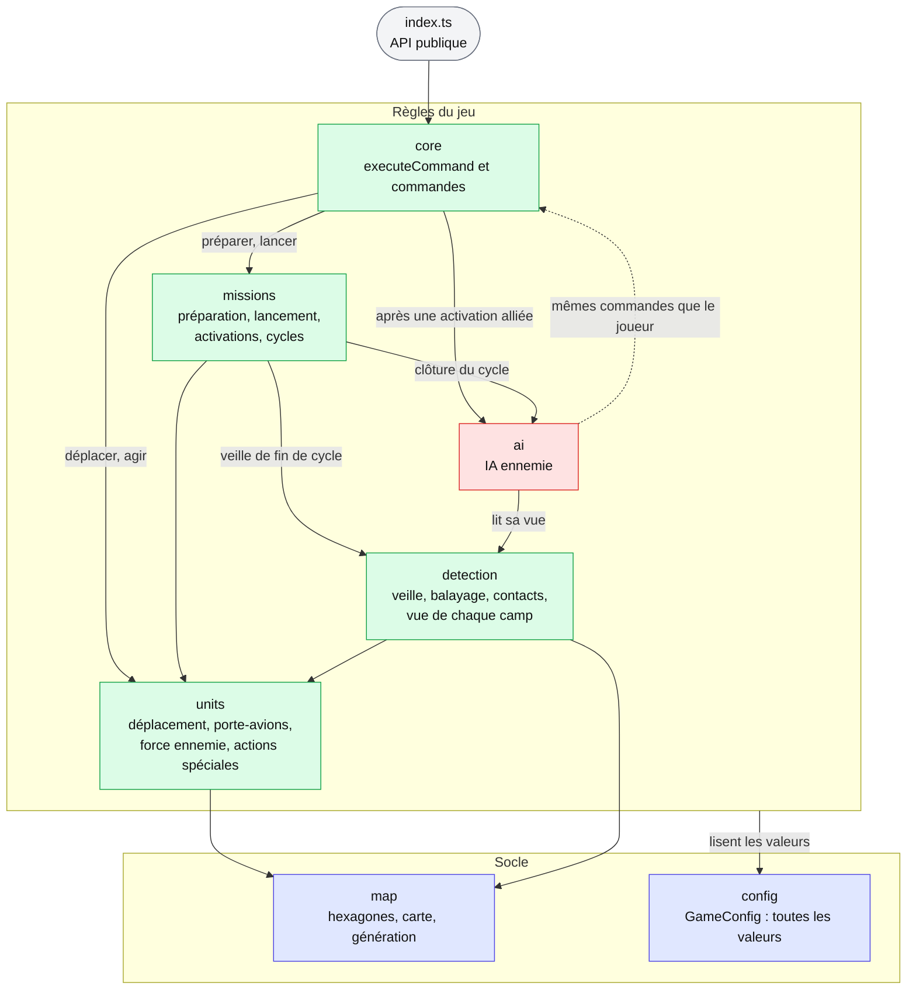

# 2. Le moteur (`src/engine/`)

Les modules du moteur et qui appelle qui. Un module = un dossier.

## Lecture

- **Un seul point d'entrée** : `executeCommand(état, commande, config)`. Il envoie vers le gestionnaire de la commande, qui s'appuie sur `units`, `detection` et `missions`.
- **`missions` gère le temps** : les activations, puis la clôture du cycle (unités ennemies, porte-avions, veille, résultat). Voir [le cycle](04-cycle.md).
- **`ai` joue avec les mêmes fonctions que le joueur** (`core/unit-commands`) : même règles, mêmes refus. Voir [l'IA](05-ia.md).
- **`config` porte toutes les valeurs du jeu** (portées, probabilités, délais) : aucune n'est écrite en dur ailleurs.
- Entre fichiers, il n'y a aucun cycle de dépendances : les flèches dans les deux sens de ce schéma (`core` et `ai`) relient des fichiers différents.

Voir aussi : [Moteur et état](../architecture/MOTEUR-ET-ETAT.md).
