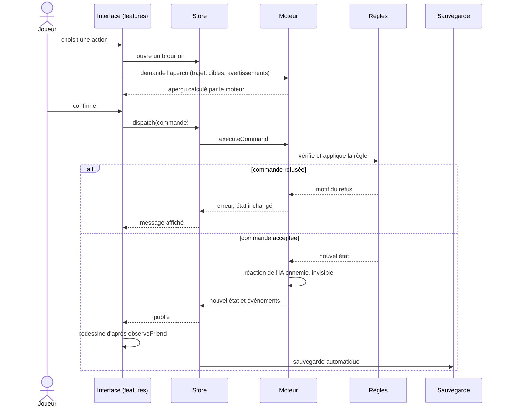

# 3. Le chemin d'une action

Ce qui se passe quand le joueur confirme une action, par exemple un déplacement, un balayage ou un tir.  
Un brouillon (`..Draft..` dans le code) concerne un état d'interface.  

