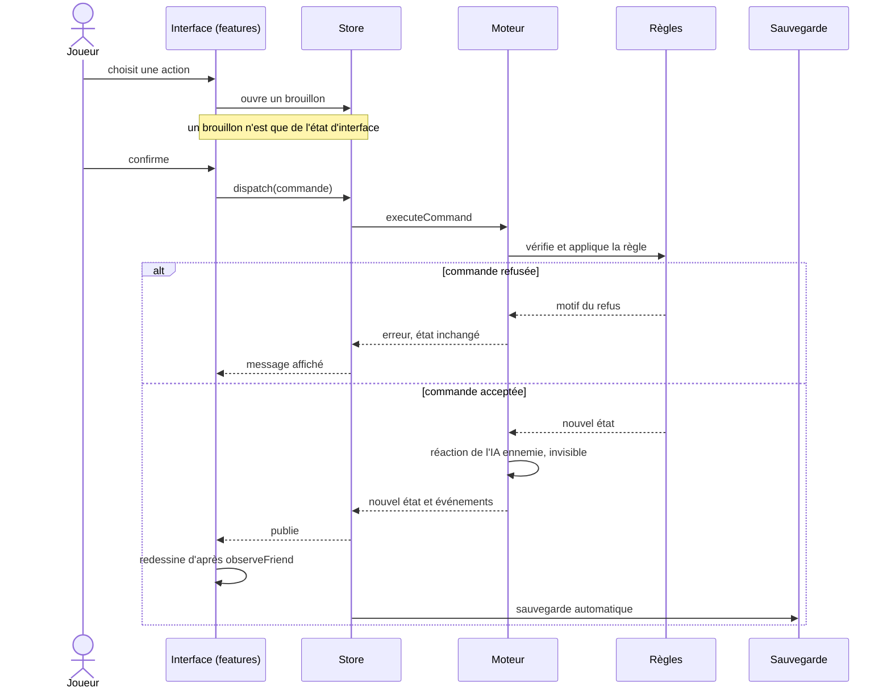

# 3. Le chemin d'une action

Ce qui se passe quand le joueur confirme une action, par exemple un déplacement ou un balayage.

## Lecture

- **Rien n'est décidé avant la confirmation** : le brouillon n'a aucun effet sur la partie.
- **Un refus ne consomme rien** : l'état reste identique et le joueur reçoit le motif.
- **La réaction ennemie est résolue avant de rendre la main** et ne produit aucun événement : le joueur n'en voit rien.
- **L'écran ne montre que la vue du joueur** (`observeFriend`) : les navires hostiles n'existent que sous forme de contacts.

Voir aussi : [Guide du développeur, §2](../architecture/GUIDE-DEVELOPPEUR.md).
