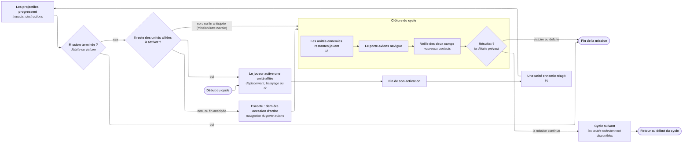

# 4. Le déroulement d'un cycle

L'enchaînement d'un cycle de jeu, avec la place de l'IA ennemie.  
Code : `missions/cycle.service.ts`, `missions/outcome.service.ts`, `core/mission-commands.service.ts`.  

