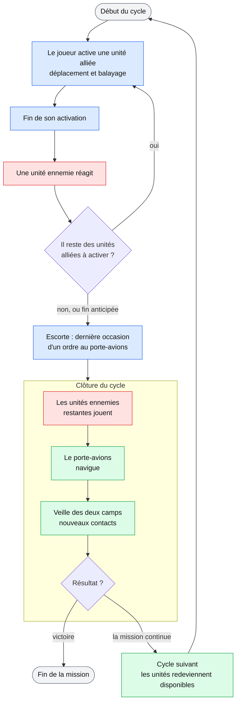

# 4. Le déroulement d'un cycle

L'enchaînement d'un cycle de jeu, avec la place de l'IA ennemie.

## Lecture

- **Tour par tour** : après chaque activation alliée, une unité ennemie joue. Chaque unité n'a qu'une activation par cycle.
- **La clôture est automatique** quand toutes les activations sont terminées. Avec « Terminer le cycle », l'activation en cours est d'abord achevée.
- **La clôture suit toujours le même ordre** : les ennemis restants jouent, le porte-avions navigue une seule fois, la veille des deux camps révèle les contacts, puis le résultat est déterminé.
- **Seule la victoire existe pour l'instant** (arrivée du porte-avions en B). Défaite et bilan arriveront avec le combat.

Code : `missions/cycle.service.ts`, `core/mission-commands.service.ts`.
