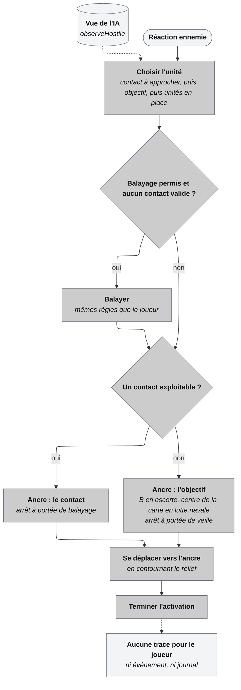

# 5. L'IA ennemie (`src/engine/ai/`)

Ce que fait l'IA pendant la réaction d'une unité ennemie.

## Lecture

- **L'IA joue comme le joueur** : mêmes commandes (`core/unit-commands`), mêmes refus, même détection. Aucun bonus caché.
- **Elle ne lit que sa vue** (`observeHostile`) : la carte, sa mission, ses unités et ses propres contacts. Elle ignore le point de départ allié ; en escorte, elle connaît le point B.
- **Sans contact, elle gagne son poste** et y tient position : près de B en escorte, au centre de la carte en lutte navale (les unités étalées en hauteur).
- **Le choix de la case** est fait sur la distance de marche, qui suit le relief. Les égalités sont départagées par un tirage reproductible.

Fichiers : `objective`, `unit-selection`, `unit-movement`, `sweep`, `turn` (tous en `.ai.service.ts`).
