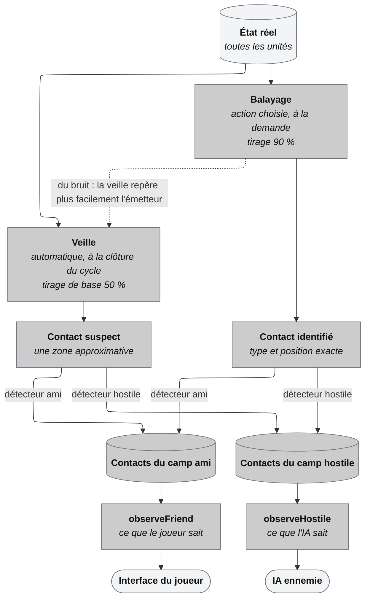

# 6. La détection et le brouillard de guerre (`src/engine/detection/`)

Comment chaque camp apprend où sont les navires adverses. Les deux camps suivent exactement les mêmes règles.

## Lecture

- **Le joueur ne voit jamais l'état réel** : un navire hostile n'existe pour lui que sous forme de contact (zone suspecte ou navire identifié).
- **Chaque camp a ses propres contacts**, construits de la même façon : `friendContacts` et `hostileContacts`, numérotés séparément.
- **Veille et balayage** : la veille est automatique et donne une zone ; le balayage est une action du joueur (ou de l'IA) qui donne le type et la position exacte, puis demande un cycle de récupération.
- **Un contact identifié est figé** à la position du balayage : il devient « ancien » au cycle suivant.
- **Rien de ce que détecte l'IA ne sort** vers le joueur : ni événement, ni journal, ni projection.

Fichiers : `watch-sensor`, `sweep`, `side-contacts`, `observation`. Portées et probabilités : `config/game.config.ts`.
