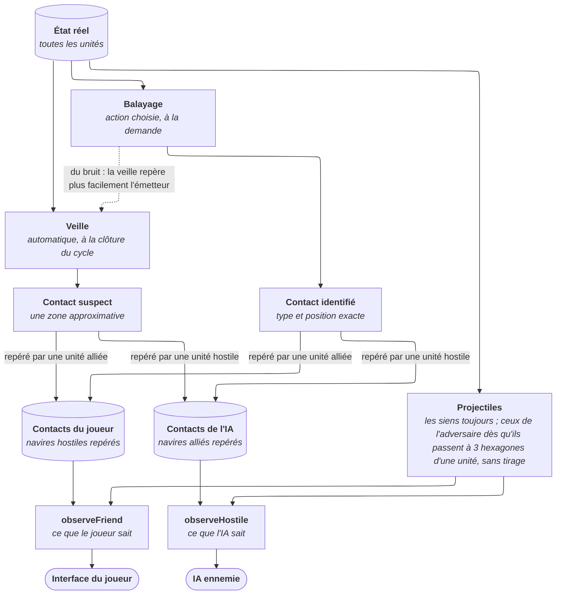

# 6. La détection et le brouillard de guerre (`src/engine/detection/`)

Comment chaque camp apprend où sont les navires adverses. Les deux camps suivent exactement les mêmes règles.  
Fichiers : `watch-sensor`, `sweep`, `side-contacts`, `observation` ; projectiles : `combat/projectile-observation`. Portées et probabilités : `config/game.config.ts`.  

