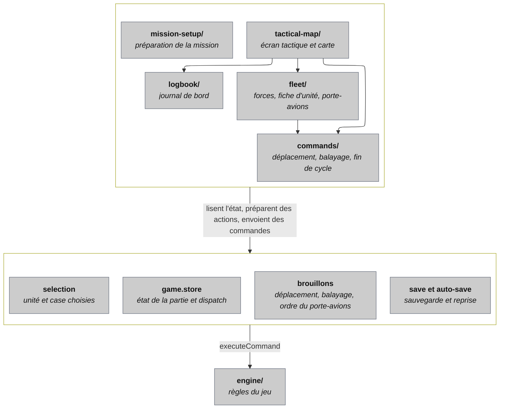

# 7. L'interface et le store

Les écrans (`src/features/`) et l'état de l'application (`src/store/`). Une feature n'importe une autre feature que par son `index.ts`.

## Lecture

- **`tactical-map` est l'écran principal** : il assemble la carte, les forces, les commandes et le journal.
- **`commands` et `fleet` écrivent dans les brouillons** : une action se prépare, puis se confirme. Un seul brouillon à la fois.
- **Seul `game.store` envoie des commandes au moteur** (via `dispatch`). L'interface lit la vue du joueur, jamais l'état réel.
- **`fleet` dépend de `commands`** (pour démarrer un déplacement), jamais l'inverse.

Voir aussi : [Guide du développeur](../architecture/GUIDE-DEVELOPPEUR.md), [maquette](../maquette/README.md).
