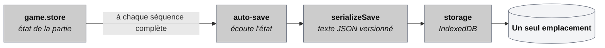
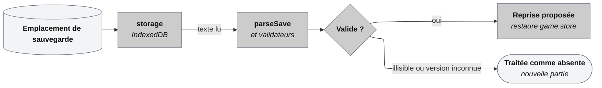

# 8. La sauvegarde et la reprise (`src/persistence/`)

Comment la partie est sauvegardée automatiquement, puis reprise au démarrage. La persistance n'est connue que du store.

## Sauvegarde

## Reprise au démarrage

## Lecture

- **Une seule sauvegarde automatique**, écrite entre deux séquences complètes (jamais pendant une activation en cours).
- **Rien de ce qui est lu n'est fiable** avant `parseSave` : validation stricte, refus total au moindre doute.
- **Version du format** (`schemaVersion`) : une sauvegarde d'une autre version est traitée comme absente, sans message ni effacement. Tout changement de la forme de l'état impose de la monter.
- **Les erreurs de stockage** ne bloquent jamais la partie.

Voir aussi : [Persistance](../architecture/PERSISTANCE.md).
