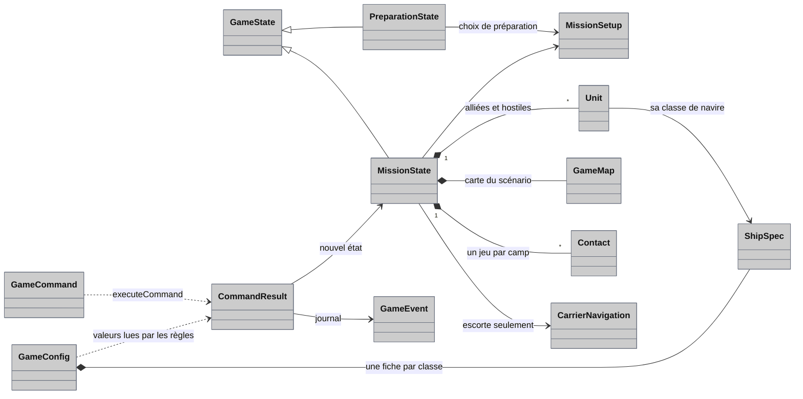

# 9. Le modèle de données

Les principaux types du moteur et leurs liens. Le code est fonctionnel (fonctions et types, pas de classes) : ce schéma utilise la notation « classes » seulement pour montrer les relations, sans les champs.

## Lecture

- **`GameState`** est soit une préparation (avant le lancement), soit une mission en cours.
- **`MissionState` est l'état réel complet** : le joueur n'y accède jamais directement, il passe par `observeFriend`.
- **`Unit` ne porte que l'état courant** : les caractéristiques de sa classe restent dans `GameConfig` (`ShipSpec`).
- **Une commande ne modifie rien** : `executeCommand` renvoie un nouvel état et des événements, ou un refus.

Fichiers : `core/game.types.ts`, `units/unit.model.ts`, `detection/contact.types.ts`, `config/game.config.ts`.
