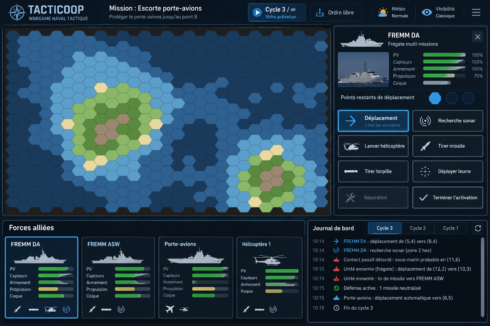
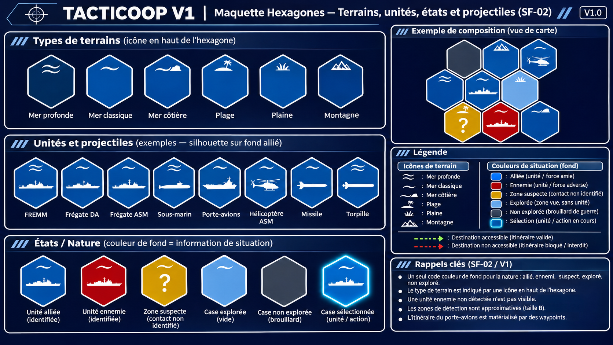

# Maquette de l'interface tactique — Tacticoop V1

## Objectif

Cette maquette constitue la **référence visuelle de l'interface tactique** de Tacticoop V1.

Elle présente l'organisation générale de l'écran, son identité graphique et la disposition des principaux composants.

Elle sert de guide pour le développement frontend avec Claude Code, sans imposer une reproduction exacte au pixel près.

S'inspirer également de [l'infographie](infographie.png) pour les cases hexagonales.

## Principes graphiques

- **Thème :** interface sombre, dominante bleu marine, inspirée des systèmes de commandement naval.
- **Carte :** représentation 2D hexagonale avec aplats de couleurs correspondant aux différents terrains.
- **Lisibilité :** privilégier la clarté des informations et des interactions plutôt que les effets graphiques complexes.
- **Cohérence :** conserver une identité visuelle homogène entre la carte, les panneaux, les boutons et les indicateurs.
- **Adaptabilité :** permettre le redimensionnement des panneaux et de la carte selon l'espace disponible.

## Organisation de l'interface

La maquette illustre cinq zones principales :

| Zone | Rôle |
|---|---|
| Barre supérieure | Mission, cycle et informations générales |
| Carte tactique | Terrain hexagonal, positionnement et interactions |
| Panneau latéral droit | Informations et commandes de l'unité sélectionnée |
| Panneau inférieur gauche | Présentation des forces alliées |
| Panneau inférieur droit | Journal de bord et historique des événements |

## Carte tactique

La carte utilise volontairement un **rendu hexagonal 2D simplifié**, sans textures photoréalistes.

Les terrains sont représentés par des couleurs distinctes. Les contours des hexagones restent visibles afin de faciliter la lecture des positions et des déplacements.

Le rendu doit rester compatible avec la génération procédurale, le zoom, la sélection des hexagones et les interactions prévues dans les spécifications fonctionnelles.

## Règles d'interprétation

Cette image est une **maquette illustrative, et non une spécification fonctionnelle**.

- Les textes, valeurs, états, positions et événements affichés sont des exemples.
- Les commandes visibles ne constituent pas une liste exhaustive ou contractuelle des actions disponibles.
- Les caractéristiques des unités, les règles de déplacement, les cycles et les mécanismes de combat sont définis dans les documents GDD et SF.
- Les éléments graphiques peuvent être adaptés pour respecter les contraintes techniques et ergonomiques.

**En cas de divergence, le Game Design et les spécifications fonctionnelles prévalent sur la maquette.**

## Références

- [Game Design](../game-design/README.md)
- [Spécifications fonctionnelles](../functional-specs/README.md)
- [Architecture technique](../architecture/README.md)